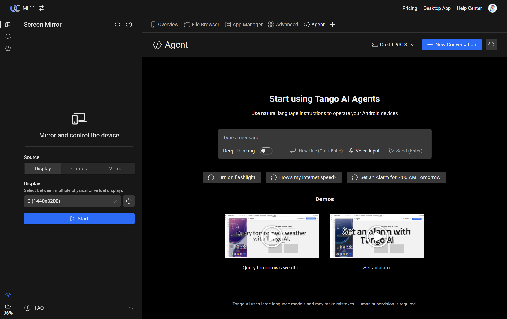
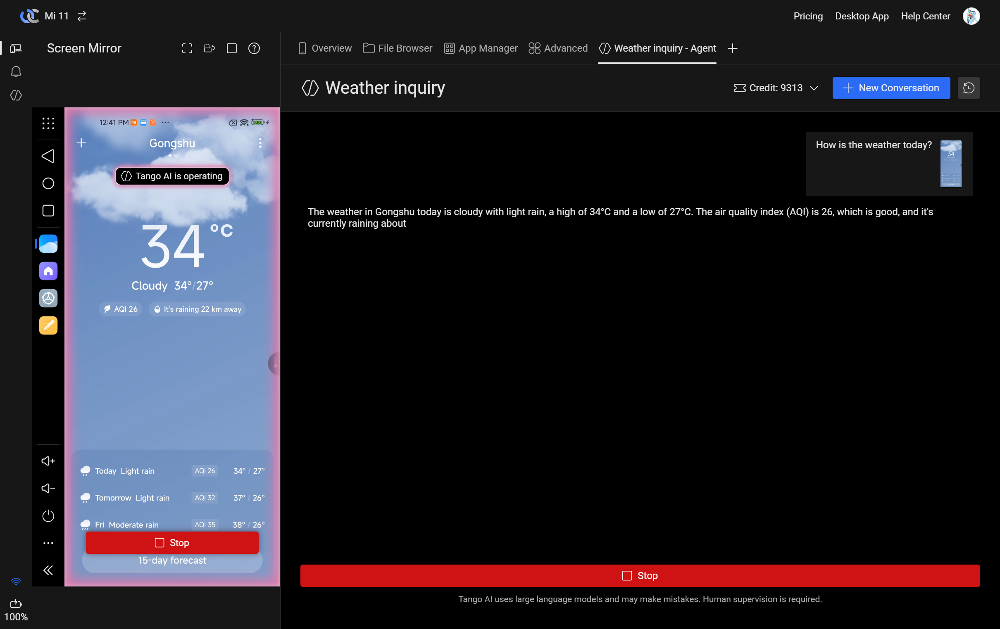
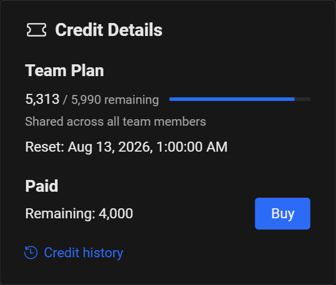
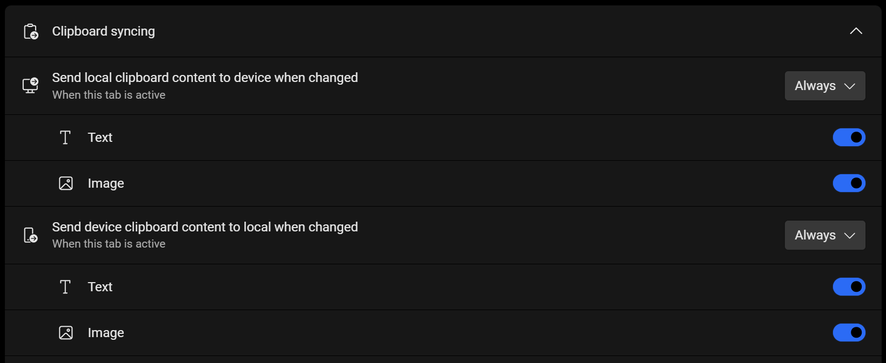

# Version 3.0: Step into AI

<head>
  <meta name="fediverse:creator" content="@yumechan@mastodon.social"/>
</head>

Version 3.0 is out. The headline feature: **Tango AI Agent** — a way to control your phone by simply describing what you want done.

{/* truncate */}

## The idea is simple

Tell your phone what you need — "open YouTube and play that song" — and it does it. No tapping through menus, no hunting for the right setting. You describe the goal; the agent figures out the steps.

It handles multi-step tasks, too. "Find the latest email from John and reply 'Got it, thanks!'" means it opens your email, finds the message, types the reply, and sends it. One instruction, several steps, done in sequence.

## How is this different from other Android AI agents?

Most Android AI agents interact with your phone the same way a finger would — tapping and swiping through the UI, one step at a time. It works, but every single action means the agent has to look at the screen, find the right spot, and tap it. "Open YouTube" alone could mean several taps through the home screen or app drawer before you even get to the app.

Tango's agent can do all of that too, but it also has a set of tools that skip the tedious parts entirely:

* **Launch apps** — open any app directly, no UI navigation needed
* **Open links and deep links** — jump straight into a specific page within an app
* **Check installed apps** — query the device without scrolling through lists
* **Enter text** — type directly into input fields
* **Use system navigation** — press back, home, or app switcher
* **Dismiss the lock screen** — if your phone doesn't have a PIN, pattern, or biometric lock

So "open YouTube and search for..." doesn't have to go through five taps to get there. The agent picks the fastest path. And when a task needs something these tools don't cover, it falls back to looking at the screen and tapping through it — which brings us to how it actually sees.

## How does it see the screen?

Most Android AI agents out there rely on Android's **accessibility tree** to understand the screen — a hidden text description that lists buttons, labels, and other UI elements. It works well enough for simple cases, but it's like trying to understand a painting by reading someone's description of it. A greyed-out button and an active one can have the same label in the accessibility tree, so the agent has no idea which one it can actually tap. A visual popup or overlay might not show up at all. Context, layout, visual cues — all lost.

Tango's agent takes a different path. It uses a **multimodal LLM** — it looks at actual screenshots of your screen, the same way you do.

The screenshots come through Scrcpy and our native server, so the capture is fast enough to feel responsive. The model then interprets what it sees: a red dot in the corner is a notification badge, a dimmed button means "not available right now," a permission dialog needs to be handled before anything else.

It's not magic — it's just a more complete picture of what's actually on screen. And that extra context makes a real difference when tasks get complicated.

## How do I use it?

Head over to the **Agent** tab in the Tango web app.

Then just start typing into the chat box. The agent walks through each step in real time, and you can stop it at any point.

After a few conversations, a side panel appears on the left with your chat history. Tap any conversation to pick up where you left off.

A few things worth knowing:

* Your **credit balance** is shown in the top-right corner
* **Deep Thinking** mode — for tasks that benefit from extra reasoning
* **Voice Input** — speak instead of typing
* **Suggested prompts** — a few starting points if you're not sure where to begin
* **Demo videos** — see it in action before trying it yourself

:::warning

Tango AI uses large language models and can make mistakes. Keep an eye on what it's doing — human supervision is still required.

:::

:::note

If your phone has a PIN, pattern, or biometric lock, you'll need to unlock it yourself before using the agent. Most features require an unlocked screen to work.

:::

## What can't it do (yet)?

It's version 1.0, so there are limits. Some are by design — the agent works in discrete steps, so anything requiring real-time reflexes or continuous interaction isn't a good fit:

* **Watching videos** — it can open YouTube, but it can't follow or react to video content
* **Fast-paced games** — it thinks before it acts, which is too slow for anything that needs split-second timing
* **Video calls and voice chats** — real-time communication needs real-time responses
* **Taking photos** — it can open the camera, but catching the right moment is still up to you
* **Drawing and sketching** — freeform input doesn't map cleanly to tap-and-swipe

## What does it cost?

Tango's existing plans haven't changed:

* **Standard** — free, with all the core features
* **Pro** — $2.99/month, with advanced screen mirror features and unlimited share links
* **Team** — $4.99/member/month, with everything in Pro plus team device sharing

Every plan now includes AI Agent access:

* **Standard**: Buy credits when you need them
* **Pro**: 3,000 credits per month
* **Team**: 6,000 credits per member, shared across the team

If you're already on Pro or Team, the AI credits are included on top of what you're paying for — roughly $3.20 (Pro) or $6.40 (Team per member) of AI usage per month.

:::note

With AI credits now included in every plan, the 30-day free trial (PayPal/credit card) and 30-day refund period (Alipay) for new subscribers have been removed. If you're currently in a trial or refund period, you won't receive AI credits this month — they'll start normally once your subscription is paid.

:::

**How far do credits go?**

Each credit covers about 400 tokens, at roughly $2.50 per million tokens.

**What's a token?** A piece of a word — about 4 characters or ¾ of a word in English. Every response costs tokens based on your message, the screenshots, and the conversation history so far.

One thing to keep in mind: longer conversations cost more per response, because the agent re-reads the full history each time. A quick "turn on Wi-Fi" costs very little. A 20-message conversation can cost 10x more per response. Starting a new conversation when you switch topics is an easy way to keep costs down.

**Where to check your credits?**

Click on the credit balance in the top-right corner to see the details:

The credit details panel shows two separate balances:

* **Your plan credits** — the monthly credits included with your subscription. On Team plans, these are shared across all team members. They reset on the date shown.
* **Paid** — credits you've purchased separately. These don't expire and are used after your plan credits run out.

Pro and Team users can also buy additional credit bundles on top of their monthly allowance. On Team plans, only managers can purchase credits. Bundles come in several sizes with volume discounts — check the [pricing page](https://app.tangoapp.dev/pricing) for details.

## Other changes

**General**

* File browser — tap an image to preview it (Motion Photo support coming later)
* Clipboard sync now has an "Always" option (previously only available during screen mirroring), with separate toggles for text and images. This replaces the old setting in Screen Mirror.
  
* Fixed device disconnections under high load
* Improved device connection flow
* More stable app list fetching
* Device onboarding page updated with the latest Android version list

**Screen Mirror**

* App launcher now has search
* Screenshots are automatically saved to clipboard
* Task switcher shows background app screenshots and lets you close apps
* Toolbar has a new screen on/off toggle (screen stays usable when off)
* Bind a physical keyboard or game controller to the virtual display (requires Android 15, results vary by device)
* Screen timeout disable now works over wireless connections (via Scrcpy)
* Added H.265 software decoding (needs a capable CPU)
* Better launch stability, especially on Android 11

## What's next?

This is the first version, and there's plenty we want to try: multi-step automation workflows, custom agent prompts, tighter desktop integration, and more. If you have ideas or just want to chat about it, we're on [Discord](https://discord.gg/26k3ttC2PN).
